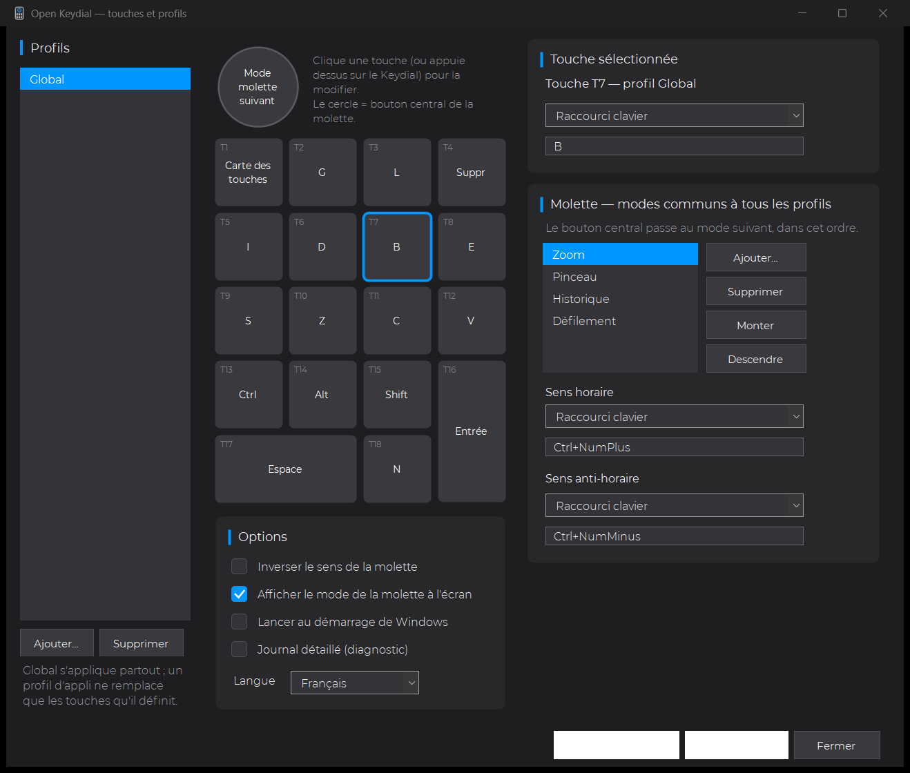

<p align="center"></p>

# Open Keydial

Un pilote Windows libre pour le **Huion Keydial Mini (K20)** en Bluetooth : ses 18 touches et sa molette,
avec des profils par application, sans le pilote Huion.

*[English version](README.md)*



## Fonctions

- Les 18 touches et le bouton central : raccourcis clavier, modificateurs maintenus tant que la touche est
  enfoncée (Ctrl, Shift, Alt), clics et molette de souris, touches multimédia, lancement d'un programme.
- Modes de molette (zoom, taille du pinceau, historique, défilement… les tiens), changés avec le bouton
  central, avec une petite bulle à l'écran.
- Profils par application : le profil Global s'applique partout, un profil d'application ne remplace que les
  touches qu'il définit. Le profil suit la fenêtre au premier plan.
- Fenêtre de configuration : clique une touche sur le dessin (ou appuie dessus sur le Keydial) et enregistre
  le raccourci.
- Carte des touches qui montre ce que fait chaque touche dans l'application en cours.
- Niveau de batterie dans l'infobulle de l'icône, alerte quand elle est faible.
- Anglais et français, interface sombre, nette à toutes les échelles d'affichage (DPI par écran).
- Un seul petit fichier portable, aucun pilote système, aucun droit administrateur, aucun accès réseau.

## Prérequis

- Windows 10 ou 11 avec Bluetooth LE.
- Un Huion Keydial Mini **K20**, appairé dans *Paramètres > Bluetooth et appareils*. Les autres modèles de
  Keydial ne sont pas encore pris en charge (leur protocole peut différer : voir [docs/protocol.md](docs/protocol.md)).
- Le pilote Huion ne doit pas tourner en même temps : Open Keydial se met en pause quand il le détecte.

## Installation

1. Télécharge `OpenKeydial.exe` depuis la [dernière version](https://github.com/Ereyptos/open-keydial/releases/latest)
   et range-le dans un dossier où il pourra rester, par exemple `%LOCALAPPDATA%\Programs\OpenKeydial`.
2. Lance-le. La fenêtre d'accueil permet de choisir la langue, de le lancer au démarrage de Windows et de
   l'ajouter au menu Démarrer.

Open Keydial est portable : il fonctionne là où tu l'as rangé, ne se copie jamais ailleurs et ne demande aucun
droit administrateur. Si tu déplaces le fichier plus tard, lance-le une fois depuis son nouvel emplacement et
ses raccourcis suivent.

| Quoi | Où |
|---|---|
| Programme | là où tu as rangé `OpenKeydial.exe` |
| Réglages et journal | `%APPDATA%\OpenKeydial\` |
| Raccourcis | Menu Démarrer, et dossier Démarrage si *Lancer au démarrage de Windows* est coché |

## Utilisation

- **Clic gauche** sur l'icône de la zone de notification : fenêtre de configuration. **Clic droit** : menu
  (mode de molette, fichier de réglages, journal, démarrage avec Windows, désinstallation).
- La molette de l'icône est bleue quand le Keydial est actif, grise quand il est en veille ou introuvable.
- Les réglages sont dans `OpenKeydial.ini`, modifiable aussi à la main : son en-tête explique la syntaxe et il
  est rechargé dès l'enregistrement.

## Désinstallation

*Désinstaller…* dans le menu de l'icône supprime les raccourcis (et tes réglages si tu veux), ferme le
programme et affiche son fichier pour que tu puisses le supprimer.

## Compilation

Il faut le compilateur C# de Visual Studio 2019 ou plus récent, ou des *Build Tools for Visual Studio*
(gratuits). Le programme cible le .NET Framework 4.8, inclus dans Windows 10 et 11.

```bat
build.cmd
```

Le résultat est `bin\OpenKeydial.exe`.

## Avertissement

Open Keydial est un projet indépendant, **sans lien avec Huion, ni approuvé ou pris en charge par Huion**.
Huion et Keydial sont des marques de leurs propriétaires respectifs, citées uniquement pour indiquer la
compatibilité. Le protocole a été établi à partir du comportement de l'appareil et des données qu'il
échange, à des fins d'interopérabilité ; aucun code ni fichier de Huion n'est inclus. Le logiciel est fourni « tel quel », sans aucune garantie
(voir la licence).

## Confidentialité

Open Keydial ne se connecte à aucun réseau et ne collecte rien. Ses réglages et son journal restent sur ton
ordinateur.

## Licence

[MIT](LICENSE). La police Montserrat intégrée est sous [SIL Open Font License 1.1](assets/fonts/OFL.txt).
