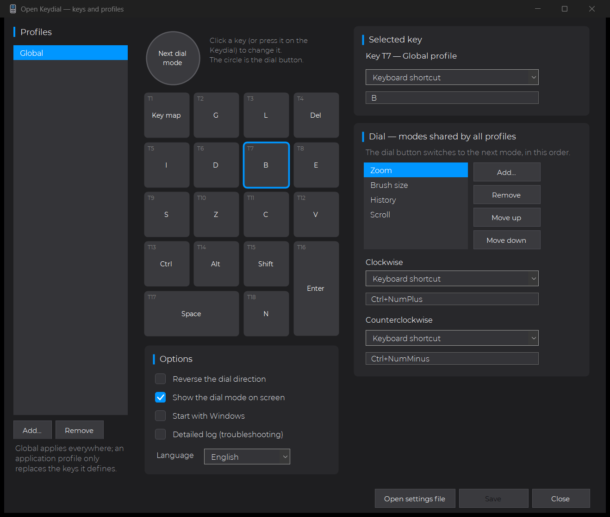
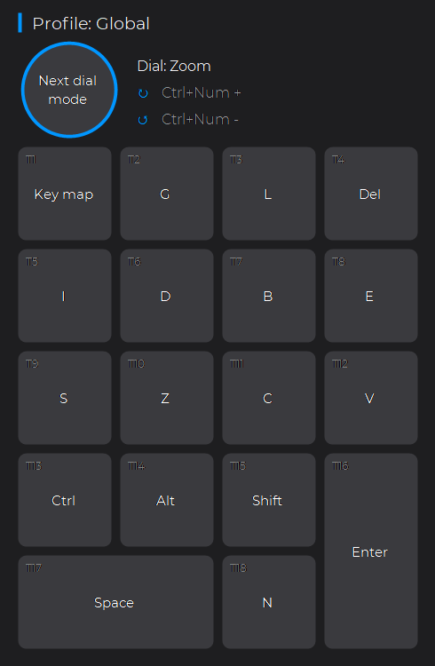

<p align="center"></p>

# Open Keydial

An open-source Windows driver for the **Huion Keydial Mini (K20)** over Bluetooth: its 18 keys and its dial,
with per-application profiles, without Huion's driver.

*[Version française](README.fr.md)*



## Features

- All 18 keys and the dial button: keyboard shortcuts, modifiers held while the key is held (Ctrl, Shift, Alt),
  mouse clicks and wheel, media keys, launching a program.
- Dial modes (zoom, brush size, history, scroll... your own), cycled with the dial button, with a small
  on-screen bubble.
- Profiles per application: the Global profile applies everywhere, an application profile only replaces the keys
  it defines. The profile follows the window in the foreground.
- Settings window: click a key on the drawing (or press it on the Keydial) and record the shortcut.
- Key map overlay showing what each key does in the current application.
- Battery level in the tray icon tooltip, warning when it runs low.
- English and French, dark interface, sharp at every display scale (per-monitor DPI).
- One small portable file, no system driver, no administrator rights, no network access.



## Requirements

- Windows 10 or 11 with Bluetooth LE.
- A Huion Keydial Mini **K20**, paired in *Settings > Bluetooth & devices*. Other Keydial models are not
  supported yet (their protocol may differ: see [docs/protocol.md](docs/protocol.md)).
- Huion's driver should not run at the same time: Open Keydial pauses itself while it detects it.

## Install

1. Download `OpenKeydial.exe` from the [latest release](https://github.com/Ereyptos/open-keydial/releases/latest)
   and put it in a folder where it can stay, for example `%LOCALAPPDATA%\Programs\OpenKeydial`.
2. Run it. The welcome window lets you choose the language, start it with Windows and add it to the Start menu.

Open Keydial is portable: it runs from where you put it, never copies itself and needs no administrator rights.
If you move the file later, launch it once from its new place and its shortcuts follow.

| What | Where |
|---|---|
| Program | wherever you put `OpenKeydial.exe` |
| Settings and log | `%APPDATA%\OpenKeydial\` |
| Shortcuts | Start menu, and the Startup folder when *Start with Windows* is on |

## Use

- **Left-click** the tray icon to open the settings window. **Right-click** for the menu (dial mode,
  settings file, log, start with Windows, uninstall).
- The icon's dial is blue when the Keydial is active, grey when it sleeps or is not found.
- The settings live in `OpenKeydial.ini`, which you can also edit by hand: its header explains the syntax
  and it reloads as soon as you save it ([default file](src/default.ini)).

## Uninstall

*Uninstall…* in the tray menu removes the shortcuts (and your settings if you want), quits, and shows the
program file so that you can delete it.

## Build from source

Requirements: the C# compiler of Visual Studio 2019 or later, or of the free *Build Tools for Visual Studio*
(the program targets the .NET Framework 4.8, which is part of Windows 10 and 11).

```bat
build.cmd
```

The result is `bin\OpenKeydial.exe`. `OpenKeydial.exe --preview-config out.png` and the other `--preview-*`
options render the windows to images without starting the driver (see `src/Previews.cs`).

## How it works

The Keydial exposes a proprietary GATT service. Open Keydial switches it to "driver mode", subscribes to its
button and dial notifications, and turns them into keyboard and mouse input with `SendInput`, depending on the
application in the foreground. Details: [docs/protocol.md](docs/protocol.md).

## Troubleshooting

- *Keydial not found*: check that it is paired and switched on, then wait a few seconds.
- Keys type letters (G, L, B...) instead of your shortcuts: the Keydial is back in its factory mode;
  Open Keydial switches it back automatically within a minute.
- For a bug report, turn on *Detailed log* in the settings, reproduce the problem and attach
  `%APPDATA%\OpenKeydial\OpenKeydial.log` to an issue.

## Privacy

Open Keydial makes no network connection and collects nothing. Its settings and log stay on your computer.

## Disclaimer

Open Keydial is an independent project, **not affiliated with, endorsed by or supported by Huion**.
Huion and Keydial are trademarks of their respective owners, used here only to describe compatibility.
The protocol was worked out from the device's behaviour and the data it exchanges, for interoperability;
no Huion code or files are included.
The software is provided "as is", without warranty of any kind (see the license).

## License

[MIT](LICENSE). The embedded Montserrat font is under the [SIL Open Font License 1.1](assets/fonts/OFL.txt).
